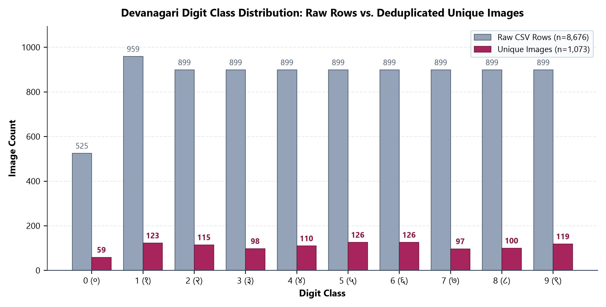
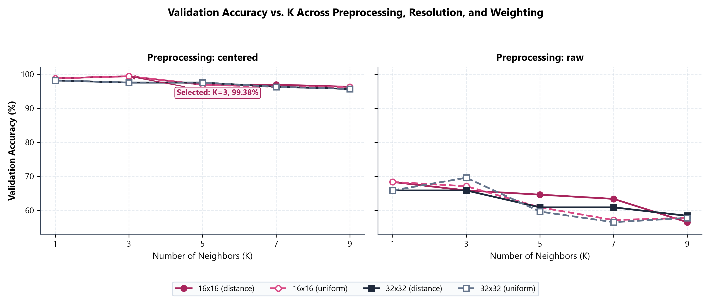
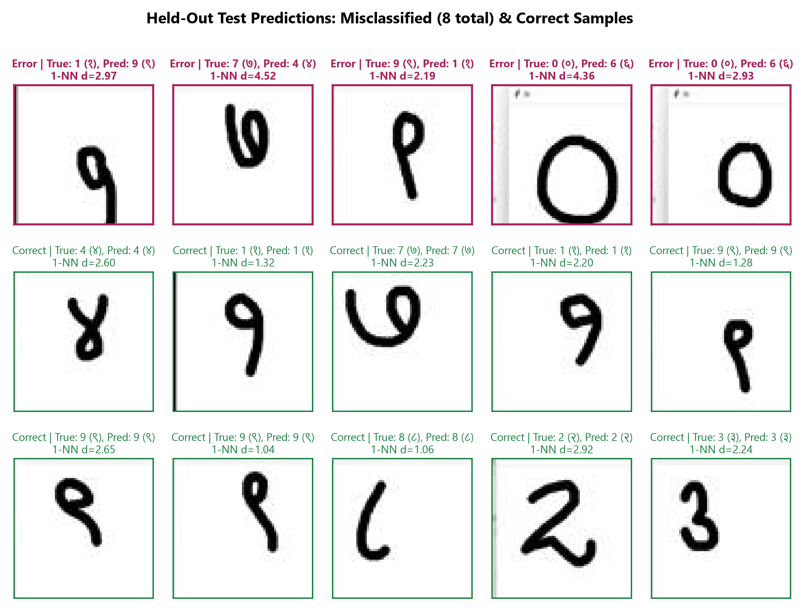

# Devanagari Handwritten Digit Recognition Using K-Nearest Neighbors (KNN)

## 1. Title Page

- **Assignment:** Assignment 3
- **Subject:** Machine Learning
- **Project Title:** Devanagari Handwritten Digit Recognition Using K-Nearest Neighbors (KNN)
- **Student Name:** Akash Kundu
- **Course:** B.Tech Computer Science and Engineering
- **Roll Number:** 231001001449
- **Date:** November 26, 2026
- **Repository:** https://github.com/AkashKundu114/knn-devanagari-digit-recognition

---

## 2. Introduction

Handwritten digit recognition is a standard classification task in supervised machine learning. Because different writers draw digits with different stroke thickness, size, slant, and placement on a canvas, an automated classifier must tolerate variation across writers while separating visually similar shapes.

While many introductory projects use the English MNIST digit dataset, this assignment applies K-Nearest Neighbors (KNN) to handwritten Devanagari numerals (`०`, `१`, `२`, `३`, `४`, `५`, `६`, `७`, `८`, `९`), corresponding to numeric classes 0 through 9. KNN is an instance-based (non-parametric) algorithm that classifies each new digit image by comparing its pixel feature vector against stored training examples using Euclidean distance.

---

## 3. Problem Statement

Given a 65 x 65 grayscale image of a handwritten Devanagari numeral drawn on a digital canvas, predict its true digit class among the ten classes 0 through 9 (`०` to `९`) using only a K-Nearest Neighbors classifier trained on pixel features, while excluding the 34 Devanagari alphabet classes present in the source dataset and preventing train-test data leakage.

---

## 4. Objectives

1. Download and inspect the actual Kaggle dataset (`sanjaypate/devanagari-script-digital-44000-images-dataset`) rather than relying on assumed folder layouts.
2. Isolate the ten Devanagari numeral classes (`0` to `9`) and exclude all alphabet files.
3. Identify and resolve data quality issues, including duplicate rows and canvas border artifacts, so no identical images leak between training, validation, and test splits.
4. Build a deterministic preprocessing pipeline (grayscale formatting, border cleanup, centering/resizing, flattening, and normalization to `[0, 1]`).
5. Compare raw resizing against centered bounding-box preprocessing at `16 x 16` and `32 x 32` resolutions across candidate `K` values (`1, 3, 5, 7, 9`) on a dedicated validation set.
6. Refit the selected KNN model on combined training and validation data and evaluate it once on the held-out test set.
7. Report measured accuracy, macro precision, macro recall, macro F1-score, per-class metrics, confusion matrix, and error analysis.

---

## 5. Dataset Description

- **Dataset Name:** DEVANAGARI HANDWRITTEN DIGITAL 44,000 IMAGES
- **Author:** Sanjay E. Pate
- **Kaggle Page:** https://www.kaggle.com/dsv/9820160 (resolved slug: `sanjaypate/devanagari-script-digital-44000-images-dataset`)
- **DOI:** `10.34740/KAGGLE/DSV/9820160`
- **License (Kaggle Listing):** CC0: Public Domain

### Actual Inspected Structure vs. Listing Summary

The Kaggle listing describes 44,000 grayscale 65 x 65 JPEG images across 44 classes (34 alphabets and 10 numerals). Inspecting the downloaded archive (`devanagari-script-digital-44000-images-dataset.zip`, 70,590,540 bytes; extracted size 1,352,070,766 bytes under `data/raw/DEVA-C-SET-CSV/`) revealed the actual structure:

- Top-level directory: `DEVA-C-SET-CSV/` containing two subdirectories: `CHAR/` and `DIGITS/`.
- Instead of `.jpg` image folders, the archive stores **CSV files** of flattened 65 x 65 grayscale pixel values (4,225 integer columns in `[0, 255]`, no header row).
- **Alphabet subset (`CHAR/CSV_FILES/`):** 35 CSV files totaling 32,855 rows (34 character classes plus a 9-row file `111.csv`). All `CHAR/` files were excluded from this project.
- **Digit subset (`DIGITS/CSV_FILES/`):** 10 CSV files (`0.csv` through `9.csv`) totaling 8,676 raw rows (all 4,225 columns valid, 0 missing/NaN values, 0 corrupt rows). Combined across `DIGITS` and `CHAR`, `CSV_FILES` contains 41,531 rows.

### Data Quality Findings

1. **Exact duplicate images:** SHA-256 hashing of the 8,676 raw rows in `DIGITS/CSV_FILES/` showed that **7,603 rows are exact byte-identical duplicates** (each unique image appears between 1 and 34 times), leaving **1,073 unique digit images** with **0 cross-class duplicates**.
2. **Leakage in pre-made `TRAIN_FILES/` and `TEST_FILES/`:** The archive also includes `DIGITS/TRAIN_FILES/` and `DIGITS/TEST_FILES/` created by splitting `CSV_FILES/` (after accidentally reading row 0 as a header). Because of the exact duplicates, nearly 100% of unique images in `TEST_FILES/` also appear identically in `TRAIN_FILES/`. Using those pre-split files directly would cause severe data leakage.
3. **Canvas border artifacts:** Several 65 x 65 images contain thin dark pixels along the outer edges (for example, window/scrollbar corners from the digital drawing canvas).

---

## 6. Dataset Collection and Preparation

The dataset was downloaded via the authenticated Kaggle CLI (`sanjaypate/devanagari-script-digital-44000-images-dataset`) on November 26, 2026 and extracted to `data/raw/`. To guarantee leakage-free evaluation:

1. All 10 files in `DIGITS/CSV_FILES/` (`0.csv` to `9.csv`) were loaded with `header=None`.
2. Each row was mapped to integer label `0` through `9` based on the filename stem.
3. Exact duplicate 65 x 65 image arrays were removed using SHA-256 hashing before any data splitting (`8,676 - 7,603 = 1,073` unique images retained).

| Digit | Glyph | Raw CSV Rows | Duplicates Removed | Unique Images Used |
|---:|:---:|---:|---:|---:|
| 0 | ० | 525 | 466 | 59 |
| 1 | १ | 959 | 836 | 123 |
| 2 | २ | 899 | 784 | 115 |
| 3 | ३ | 899 | 801 | 98 |
| 4 | ४ | 899 | 789 | 110 |
| 5 | ५ | 899 | 773 | 126 |
| 6 | ६ | 899 | 773 | 126 |
| 7 | ७ | 899 | 802 | 97 |
| 8 | ८ | 899 | 799 | 100 |
| 9 | ९ | 899 | 780 | 119 |
| **Total** | **०-९** | **8,676** | **7,603** | **1,073** |

---

## 7. Image Preprocessing

Two deterministic per-image preprocessing modes were implemented in `src/data_loader.py` and compared on the validation set:

1. **Raw mode (`raw`):** Directly resizes each 65 x 65 grayscale image to `S x S` (`16 x 16` or `32 x 32`) using Lanczos resampling.
2. **Centered mode (`centered`):**
   - Clears a 3-pixel border around the 65 x 65 image (sets border pixels to white `255`) to suppress canvas frame lines.
   - Detects ink pixels (`intensity < 200`) and extracts the tight bounding box around the digit.
   - Pads the cropped digit symmetrically with white pixels (`255`) to form a square so aspect ratio is preserved.
   - Resizes the square crop to `(S - 2) x (S - 2)` with Lanczos resampling and places it centered on a white `S x S` canvas (1-pixel margin).

Because both modes operate independently on each image without fitting dataset-wide statistics, there is no leakage across splits.

---

## 8. Feature Extraction

After resizing to `S x S` pixels:

1. The 2D grayscale matrix is flattened row-by-row into a 1D vector:
   - `16 x 16` produces `256` features per image.
   - `32 x 32` produces `1,024` features per image.
2. Integer pixel intensities in `[0, 255]` are cast to `float32` and divided by `255.0` to normalize every feature into `[0.0, 1.0]`.

Using compact spatial resolutions reduces dimensionality relative to the raw 4,225-pixel vector (`65 x 65`), lowers memory and distance-computation cost, and provides tolerance to minor stroke-width differences.

---

## 9. Explanation of the KNN Algorithm

K-Nearest Neighbors (KNN) is a supervised, non-parametric, lazy learning algorithm:

- **Training phase:** KNN stores the feature vectors `x_i` and labels `y_i` of the training set without fitting parametric weights.
- **Prediction phase:** Given a test image vector `q`, KNN computes the distance from `q` to every stored training vector, selects the `K` closest neighbors `N_K(q)`, and assigns a class label by voting.
- **Distance-weighted voting:** Instead of giving all `K` neighbors equal weight, each neighbor `i` in `N_K(q)` receives weight `w_i = 1 / d(q, x_i)` (if `d(q, x_i) = 0`, that exact match receives weight infinity and dictates the label). The predicted class maximizes the sum of neighbor weights:

$$\hat{y}(q) = \arg\max_{c \in \{0,\dots,9\}} \sum_{i \in N_K(q)} w_i \cdot \mathbf{1}(y_i = c)$$

Smaller `K` values follow local decision boundaries closely (higher variance), while larger `K` values smooth over noisy examples (higher bias).

---

## 10. Mathematical Explanation of Euclidean Distance

For two normalized `D`-dimensional image feature vectors `p = (p_1, p_2, ..., p_D)` and `q = (q_1, q_2, ..., q_D)` (where `D = 256` for `16 x 16` images or `D = 1,024` for `32 x 32` images), the Euclidean (`L2`) distance is:

$$d(\mathbf{p}, \mathbf{q}) = \sqrt{\sum_{j=1}^{D} (p_j - q_j)^2}$$

Each term `(p_j - q_j)^2` measures the squared intensity difference at pixel position `j`. Squaring penalizes large pixel mismatches more strongly than small variations. Because every pixel is normalized to `[0, 1]`, no single feature dominates due to scale differences.

Notice why spatial centering directly affects Euclidean distance: if two writers draw the same digit `२` in different corners of a 65 x 65 canvas, their dark ink pixels occupy disjoint coordinates `j`, causing a large Euclidean distance under `raw` resizing. Centering aligns the bounding boxes so pixel coordinates match structurally.

---

## 11. Data Splitting

The 1,073 unique digit images were partitioned using stratified splitting with `random_state = 42` in `src/train_evaluate.py`:

| Split | Share | Sample Count | Purpose |
|---|---:|---:|---|
| Training set | 70% | 751 | Fit candidate KNN models during selection |
| Validation set | 15% | 161 | Select preprocessing mode, image size, and `K` |
| Combined Train + Val | 85% | 912 | Refit final selected KNN model |
| Held-out Test set | 15% | 161 | Single final unbiased evaluation |

Stratification preserves the class proportions (`0` through `9`) across all three partitions. Set-intersection checks in the code verify zero index overlap between training, validation, and test sets, and the test set is never inspected during hyperparameter selection.

---

## 12. Model Training and Hyperparameter Selection

Using Scikit-learn's `KNeighborsClassifier(metric="euclidean", weights="distance", n_jobs=-1)`, 20 candidate configurations were evaluated on the validation set (`161` samples):

- Preprocessing modes: `raw`, `centered`
- Image sizes: `16 x 16` (256 features), `32 x 32` (1,024 features)
- Neighbor counts: `K in {1, 3, 5, 7, 9}`

Selection rule: highest validation accuracy, breaking ties by smaller image size and smaller `K`. After selecting the winning configuration (`centered`, `16 x 16`, `K = 3`), the training and validation splits (`751 + 161 = 912` samples) were combined to refit the final model before evaluating once on the `161` test samples.

---

## 13. Implementation Steps

1. Download `sanjaypate/devanagari-script-digital-44000-images-dataset` from Kaggle and extract under `data/raw/`.
2. Load `DIGITS/CSV_FILES/0.csv` through `9.csv` via `src/data_loader.py` (`load_raw_digit_dataset`), skipping any malformed rows and excluding `CHAR/`.
3. Remove exact SHA-256 duplicate rows (`7,603` duplicates) to retain `1,073` unique digit images.
4. Generate disjoint stratified index splits (`751` train, `161` validation, `161` test) with `random_state = 42`.
5. Build normalized feature matrices in `raw` and `centered` modes for `16 x 16` and `32 x 32` resolutions (`preprocess_images`).
6. Run validation grid search across `K in {1, 3, 5, 7, 9}` and save `results/k_comparison.csv` and `results/k_validation_curve.png`.
7. Refit the top validation configuration on `train + validation` (`912` samples) and predict on the held-out test set (`161` samples).
8. Save all metrics, inspection summaries, confusion matrix, classification report, sample predictions, and plots under `results/`.
9. Verify correctness with `compileall` and the `pytest` suite under `tests/test_pipeline.py`.

---

## 14. Experimental Setup

- **Hardware & OS:** Windows 11 (`AMD64 Family 25 Model 97 Stepping 2`, 32 logical CPUs)
- **Software Environment:** Python 3.14.6, NumPy 2.4.6, Pandas 3.0.5, Pillow 12.3.0, Scikit-learn 1.9.1, Matplotlib 3.11.1
- **Random Seed:** `42`
- **Execution Command:** `python -m src.train_evaluate --data-dir data/raw --output-dir results`
- **Measured Timings:**
  - Data loading & deduplication: `9.9218 s`
  - Validation grid search (20 configurations): `2.4290 s`
  - Final model fit (`912` samples): `0.0010 s`
  - Test inference (`161` samples): `0.0190 s`

---

## 15. Actual Results

### Validation Grid Results

| Preprocessing | Image Size | Features | K=1 | K=3 | K=5 | K=7 | K=9 |
|---|---|---:|---:|---:|---:|---:|---:|
| `centered` | `16 x 16` | 256 | 98.76% | **99.38%** | 96.89% | 96.89% | 96.27% |
| `centered` | `32 x 32` | 1,024 | 98.14% | 97.52% | 97.52% | 96.27% | 95.65% |
| `raw` | `16 x 16` | 256 | 68.32% | 65.84% | 64.60% | 63.35% | 56.52% |
| `raw` | `32 x 32` | 1,024 | 65.84% | 65.84% | 60.87% | 60.87% | 58.39% |

**Selected Configuration:** `preprocess_mode = centered`, `image_size = 16 x 16` (`256` features), `K = 3`, `metric = euclidean`, `weights = distance` (validation accuracy = `99.38%`).

### Final Held-Out Test Metrics (`161` Test Images)

| Metric | Measured Value |
|---|---:|
| Test Accuracy | **95.03%** (`153 / 161` correct) |
| Macro Precision | **95.82%** |
| Macro Recall | **94.29%** |
| Macro F1-Score | **94.86%** |
| Weighted Precision | **95.29%** |
| Weighted Recall | **95.03%** |
| Weighted F1-Score | **95.01%** |

### Per-Class Test Performance

| Digit | Glyph | Precision | Recall | F1-Score | Support |
|---:|:---:|---:|---:|---:|---:|
| 0 | ० | 1.0000 | 0.7778 | 0.8750 | 9 |
| 1 | १ | 0.8889 | 0.8889 | 0.8889 | 18 |
| 2 | २ | 1.0000 | 1.0000 | 1.0000 | 17 |
| 3 | ३ | 1.0000 | 1.0000 | 1.0000 | 15 |
| 4 | ४ | 0.9375 | 0.9375 | 0.9375 | 16 |
| 5 | ५ | 0.9474 | 0.9474 | 0.9474 | 19 |
| 6 | ६ | 0.8636 | 1.0000 | 0.9268 | 19 |
| 7 | ७ | 1.0000 | 0.9333 | 0.9655 | 15 |
| 8 | ८ | 1.0000 | 1.0000 | 1.0000 | 15 |
| 9 | ९ | 0.9444 | 0.9444 | 0.9444 | 18 |

---

## 16. Confusion Matrix

The matrix below reports actual test labels (rows) against predicted test labels (columns) across the 161 held-out test images:

| True \ Pred | 0 (०) | 1 (१) | 2 (२) | 3 (३) | 4 (४) | 5 (५) | 6 (६) | 7 (७) | 8 (८) | 9 (९) |
|---|---:|---:|---:|---:|---:|---:|---:|---:|---:|---:|
| **0 (०)** | **7** | 0 | 0 | 0 | 0 | 0 | 2 | 0 | 0 | 0 |
| **1 (१)** | 0 | **16** | 0 | 0 | 0 | 0 | 1 | 0 | 0 | 1 |
| **2 (२)** | 0 | 0 | **17** | 0 | 0 | 0 | 0 | 0 | 0 | 0 |
| **3 (३)** | 0 | 0 | 0 | **15** | 0 | 0 | 0 | 0 | 0 | 0 |
| **4 (४)** | 0 | 0 | 0 | 0 | **15** | 1 | 0 | 0 | 0 | 0 |
| **5 (५)** | 0 | 1 | 0 | 0 | 0 | **18** | 0 | 0 | 0 | 0 |
| **6 (६)** | 0 | 0 | 0 | 0 | 0 | 0 | **19** | 0 | 0 | 0 |
| **7 (७)** | 0 | 0 | 0 | 0 | 1 | 0 | 0 | **14** | 0 | 0 |
| **8 (८)** | 0 | 0 | 0 | 0 | 0 | 0 | 0 | 0 | **15** | 0 |
| **9 (९)** | 0 | 1 | 0 | 0 | 0 | 0 | 0 | 0 | 0 | **17** |

---

## 17. Performance Analysis

1. **Impact of spatial centering (`centered` vs. `raw`):** Without bounding-box centering, KNN validation accuracy peaks at only `68.32%` (`16 x 16`, `K=1`). Adding border cleanup and tight bounding-box centering increases validation accuracy to `99.38%` (`16 x 16`, `K=3`), a gain of `+31.06` percentage points. This confirms that raw pixel Euclidean distance is sensitive to translation and scale differences on the 65 x 65 drawing canvas.
2. **Resolution comparison (`16 x 16` vs. `32 x 32`):** Across both preprocessing modes, `16 x 16` (`256` features) matches or outperforms `32 x 32` (`1,024` features) while cutting prediction latency roughly in half (`~0.020 s` vs. `~0.045 s`). Slight downsampling smooths thin stroke shifts and avoids higher-dimensional sparsity.
3. **Effect of `K`:** Validation accuracy peaks at `K=3` (`99.38%`) for `centered 16 x 16` and gradually decreases as `K` increases to `5`, `7`, and `9` (`96.27%`), because larger neighborhoods pull in examples from visually nearby classes when per-class training counts are around 41 to 88 samples.
4. **Validation vs. Test gap:** Validation accuracy (`99.38%`) is higher than test accuracy (`95.03%`, 8 errors out of 161), which is expected on a 161-sample split where each single sample equals `0.62%` accuracy.
5. **Error analysis of the 8 misclassifications:**
   - **Canvas toolbar artifacts (`0 -> 6`, 2 errors):** Visual inspection of the misclassified test samples (`results/prediction_samples.png`) shows that two `0 (०)` images contained a faint toolbar artifact beyond 3 pixels in the top-left corner of the 65 x 65 image. That artifact expanded the detected bounding box upward and shifted the circular `0` into the lower-right, matching `6` samples that shared similar corner artifacts.
   - **Structural similarity (`1 <-> 9`, 2 errors):** Devanagari `१` and `९` both consist of a top loop and a descending tail, causing one `1` to be predicted as `9` and one `9` as `1`.
   - **Remaining isolated errors (4 errors):** One `1 -> 6`, one `4 -> 5`, one `5 -> 1`, and one `7 -> 4`, all reflecting curved loop or stem similarity in individual handwriting styles.

---

## 18. Sample Predictions

All 161 test predictions are saved in `results/sample_predictions.csv`. Representative examples (including misclassifications and correct predictions) are summarized below:

| Test Index | Source Row | True Label | Predicted Label | Nearest Neighbor Distance | Outcome |
|---:|---|:---:|:---:|---:|:---|
| 486 | `4.csv#row_724` | 4 (४) | 4 (४) | 2.6050 | Correct |
| 895 | `8.csv#row_424` | 8 (८) | 8 (८) | 1.5791 | Correct |
| 350 | `3.csv#row_450` | 3 (३) | 3 (३) | 3.4530 | Correct |
| 232 | `2.csv#row_336` | 2 (२) | 2 (२) | 3.1793 | Correct |
| 129 | `1.csv#row_530` | 1 (१) | 9 (९) | 2.9716 | Misclassified |
| 1047 | `9.csv#row_725` | 9 (९) | 1 (१) | 2.1949 | Misclassified |
| 14 | `0.csv#row_112` | 0 (०) | 6 (६) | 2.9269 | Misclassified |
| 793 | `7.csv#row_372` | 7 (७) | 4 (४) | 4.5217 | Misclassified |

---

## 19. Advantages and Limitations

### Advantages of KNN for This Task

- Simple to implement, inspect, and explain mathematically.
- Zero parametric optimization required; training is instantaneous (`0.0010 s` for 912 samples).
- Works well on small-to-medium clean datasets (`1,073` unique images) once spatial centering is applied.
- Predictions are directly interpretable by inspecting the `K` nearest training images and their distances.

### Limitations Observed

- **Sensitivity to translation and artifacts:** Raw pixel Euclidean distance drops to `68.32%` validation accuracy when digits are not centered, and corner artifacts in two test `0` images misled bounding-box cropping.
- **Inference scaling:** Prediction compares a query against every stored training sample (`O(N * D)`), so memory and latency grow linearly with training set size.
- **Small unique sample count:** Although the raw dataset lists thousands of rows, removing exact duplicates leaves `1,073` unique images (only `59` for class `0` and `9` test samples for class `0`).
- **Domain scope:** Samples were drawn digitally on a Python canvas; results do not establish generalization to noisy paper scans, camera photos, or skewed multi-digit lines.

---

## 20. Conclusion

This project implemented and evaluated a complete, reproducible KNN pipeline for handwritten Devanagari digit recognition (`०` through `९`). Inspecting the real Kaggle dataset uncovered two critical properties: the archive stores 65 x 65 pixel matrices in CSV files rather than JPEG folders, and `DIGITS/CSV_FILES/` contains `7,603` exact duplicate rows out of `8,676` rows. Deduplicating to `1,073` unique images before stratified splitting prevented train-test leakage. On the validation set, centered `16 x 16` grayscale features with `K = 3`, Euclidean distance, and distance-weighted voting achieved `99.38%` validation accuracy (outperforming raw `16 x 16` at `68.32%` and `32 x 32` configurations). Evaluated once on the held-out `161`-image test set after refitting on `912` combined train and validation images, the final KNN classifier achieved **95.03% test accuracy**, **95.82% macro precision**, **94.29% macro recall**, and **94.86% macro F1-score**.

---

## 21. References

1. Sanjay E. Pate, *DEVANAGARI HANDWRITTEN DIGITAL 44,000 IMAGES*, Kaggle, DOI: `10.34740/KAGGLE/DSV/9820160`, https://www.kaggle.com/datasets/sanjaypate/devanagari-script-digital-44000-images-dataset.
2. T. Cover and P. Hart, "Nearest neighbor pattern classification," *IEEE Transactions on Information Theory*, vol. 13, no. 1, pp. 21-27, 1967.
3. Pedregosa et al., "Scikit-learn: Machine Learning in Python," *Journal of Machine Learning Research*, vol. 12, pp. 2825-2830, 2011 (`sklearn.neighbors.KNeighborsClassifier`).

---

## 22. GitHub Repository Link

https://github.com/AkashKundu114/knn-devanagari-digit-recognition
