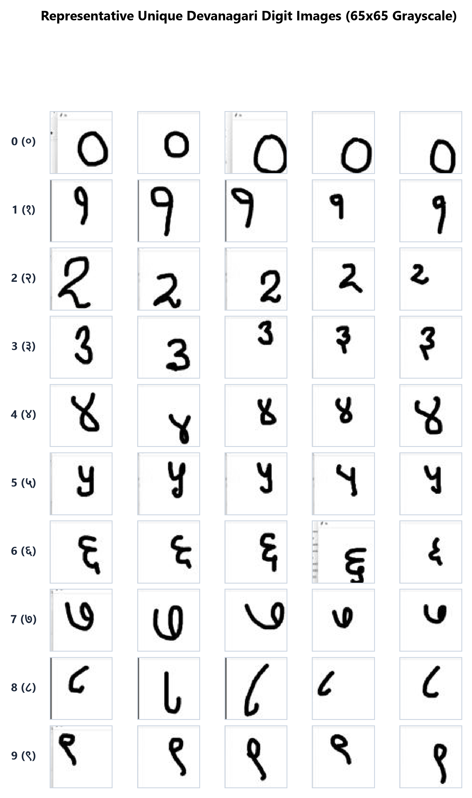
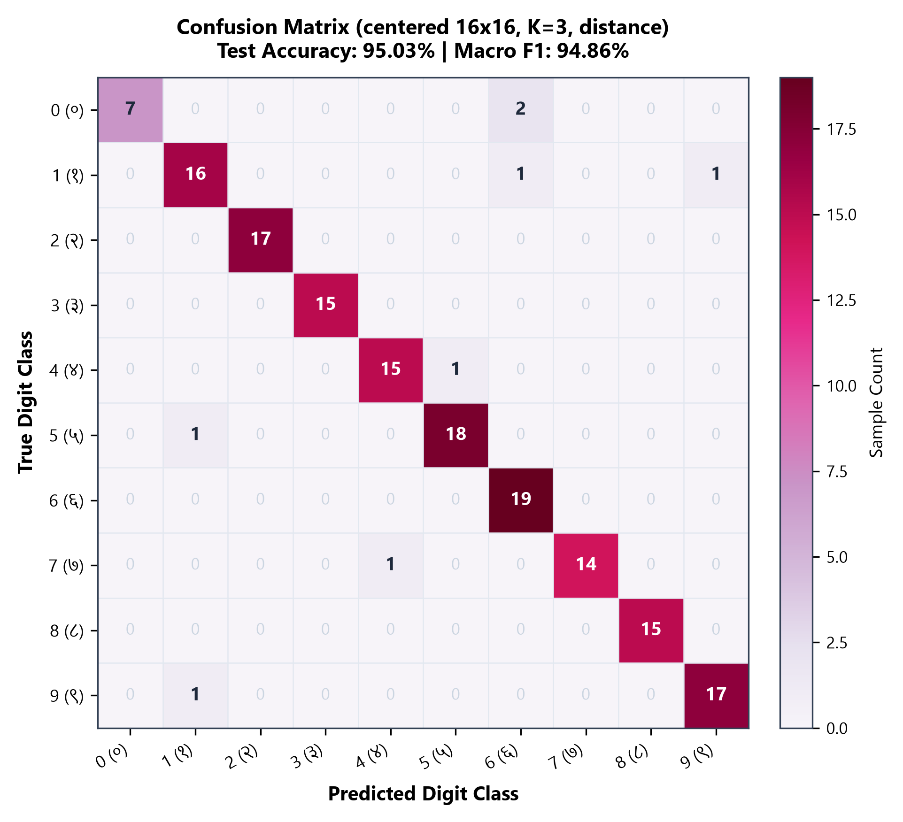

# Devanagari Handwritten Digit Recognition Using K-Nearest Neighbors (KNN)

**Assignment:** Machine Learning Assignment 3  
**Name:** Akash Kundu  
**Course:** B.Tech Computer Science and Engineering  
**Roll Number:** 231001001449  
**Repository:** https://github.com/AkashKundu114/knn-devanagari-digit-recognition  

---

## 1. Introduction and Objective

Handwritten digit recognition is a supervised classification problem in which an algorithm maps grayscale images of handwritten numerals to discrete digit labels (0 to 9). Different writers produce variations in stroke thickness, curvature, size, and canvas placement, making raw pixel matching sensitive without consistent preprocessing.

The objective of this assignment is to implement and evaluate K-Nearest Neighbors (KNN) for classifying isolated handwritten Devanagari numerals (`०` through `९`, classes 0 to 9) from an actual Kaggle dataset, excluding all alphabet classes, preventing train-test leakage, selecting hyperparameters on a dedicated validation split, and reporting measured held-out test performance.

## 2. Dataset and Tools

- **Dataset Source:** *DEVANAGARI HANDWRITTEN DIGITAL 44,000 IMAGES* by Sanjay E. Pate ([Kaggle](https://www.kaggle.com/dsv/9820160), slug `sanjaypate/devanagari-script-digital-44000-images-dataset`, DOI: `10.34740/KAGGLE/DSV/9820160`, CC0 Public Domain).
- **Inspected Structure and Data Quality:** Although the Kaggle listing describes 44,000 JPEG images across 44 classes, inspecting the downloaded archive (`DEVA-C-SET-CSV/`) showed that it stores flattened 65 x 65 grayscale pixel rows (4,225 integer columns in `[0, 255]`, no header) in CSV files:
  - **Excluded alphabet classes:** `CHAR/CSV_FILES/` contains 35 CSV files (`32,855` rows), all excluded.
  - **Selected digit classes (0 to 9):** `DIGITS/CSV_FILES/` contains 10 files (`0.csv` to `9.csv`) totaling `8,676` rows (`0` NaN or corrupt rows).
  - **Deduplication:** SHA-256 hashing detected `7,603` exact duplicate rows (`0` cross-class duplicates). Pre-split `TRAIN_FILES/` and `TEST_FILES/` in the archive split these duplicates across both sets (near-100% overlap) and misread row 0 as a header. Removing exact duplicates yields **1,073 unique digit images** (`0:59, 1:123, 2:115, 3:98, 4:110, 5:126, 6:126, 7:97, 8:100, 9:119`).
- **Tools Used:** Python `3.14.6`, NumPy `2.4.6`, Pandas `3.0.5`, Pillow `12.3.0`, Scikit-learn `1.9.1`, Matplotlib `3.11.1`, and Pytest.

## 3. Methodology and Implementation

The pipeline is implemented in [src/data_loader.py](../src/data_loader.py) and [src/train_evaluate.py](../src/train_evaluate.py):

1. **Preprocessing and feature extraction:** Two per-image modes were compared at `16 x 16` (`256` features) and `32 x 32` (`1,024` features): `raw` (direct Lanczos resize) and `centered` (3-pixel border cleanup, tight bounding-box crop on ink `< 200`, symmetric square padding, Lanczos resize with 1 px margin). Pixel values are flattened and divided by `255.0` so all features lie in `[0, 1]`. Normalization ensures every pixel coordinate contributes on an equal scale.
2. **Data splitting:** The `1,073` unique images were split via stratified sampling (`random_state = 42`) into **751** training (70%), **161** validation (15%), and **161** test (15%) samples, with zero index overlap.
3. **KNN classifier and Euclidean distance:** KNN is a supervised, instance-based algorithm that stores training vectors and classifies a query vector $x$ using the $K$ nearest training neighbors $y$. For $n$-dimensional normalized vectors $x$ and $y$, Euclidean distance is:

$$d(x, y) = \sqrt{\sum_{i=1}^{n}(x_i - y_i)^2}$$

We compared `uniform` majority voting (equal vote per neighbor) against `distance`-weighted voting (weight $1 / d(x, y)$) for $K \in \{1, 3, 5, 7, 9\}$ using the validation split only, then refitted on combined train + validation (`912` images) before one final test evaluation.

## 4. Results and Evaluation

Without centering, raw pixel Euclidean distance reaches at most `69.57%` (`raw`, `32 x 32`, `uniform`, `K = 3`), whereas bounding-box centering reaches **99.38%** (`centered`, `16 x 16`, `K = 3`, `distance` and `uniform` tied; `distance` selected by tie-break). Smaller resolution (`16 x 16`, `256` features) tolerates minor stroke shifts better than `32 x 32` while cutting prediction latency roughly in half (`~0.02 s` vs. `~0.04 s`).

| Mode | Size (Features) | Weighting | K=1 | K=3 | K=5 | K=7 | K=9 |
|---|---|---|---:|---:|---:|---:|---:|
| centered | 16x16 (256) | distance | 98.76% | **99.38%** | 96.89% | 96.89% | 96.27% |
| centered | 16x16 (256) | uniform | 98.76% | 99.38% | 96.89% | 96.27% | 96.27% |
| centered | 32x32 (1024) | distance | 98.14% | 97.52% | 97.52% | 96.27% | 95.65% |
| centered | 32x32 (1024) | uniform | 98.14% | 97.52% | 97.52% | 96.27% | 95.65% |
| raw | 16x16 (256) | distance | 68.32% | 65.84% | 64.60% | 63.35% | 56.52% |
| raw | 16x16 (256) | uniform | 68.32% | 67.08% | 60.87% | 57.14% | 57.76% |
| raw | 32x32 (1024) | distance | 65.84% | 65.84% | 60.87% | 60.87% | 58.39% |
| raw | 32x32 (1024) | uniform | 65.84% | 69.57% | 59.63% | 56.52% | 57.76% |

### Final Held-Out Test Metrics (`161` Images, `centered 16x16, K=3, distance`)

| Split Counts (Train / Val / Refit / Test) | Test Accuracy | Macro Precision | Macro Recall | Macro F1-Score |
|---|---:|---:|---:|---:|
| 751 / 161 / 912 / 161 | **95.03%** (153/161) | 95.82% | 94.29% | 94.86% |

On the held-out test set, classes 2, 3, and 8 achieved `1.0000` F1-score, and class 6 achieved `1.0000` recall. Out of `8` total misclassifications among `161` test images, two digit 0 errors predicted class 6 due to faint canvas toolbar artifacts beyond the 3-pixel border shifting their bounding box, and two errors occurred between structurally similar loops 1 and 9.

## 5. Conclusion

We implemented a reproducible KNN pipeline for Devanagari digits 0 to 9 in `src/`. Inspecting the Kaggle CSV archive uncovered `7,603` exact duplicate rows; deduplicating to `1,073` unique images prevented data leakage. Bounding-box centering with `16 x 16` grayscale features, Euclidean distance, `K = 3`, and `distance` weighting achieved `99.38%` validation accuracy and **95.03%** test accuracy (`94.86%` macro F1-score).

**Limitations and Future Improvements:** (1) Removing duplicates leaves only `1,073` unique samples (`59` for digit 0), and (2) KNN inference scales linearly with training set size $O(N \cdot D)$. Future improvements include connected-component border noise removal to eliminate corner artifacts and testing feature descriptors such as Histogram of Oriented Gradients (HOG) or PCA dimensionality reduction.

## 6. References

1. Sanjay E. Pate, *DEVANAGARI HANDWRITTEN DIGITAL 44,000 IMAGES*, Kaggle, DOI: `10.34740/KAGGLE/DSV/9820160`, https://www.kaggle.com/dsv/9820160.
2. Scikit-learn Documentation, `sklearn.neighbors.KNeighborsClassifier`, https://scikit-learn.org/stable/modules/generated/sklearn.neighbors.KNeighborsClassifier.html.
3. Pillow Documentation, `Image.Resampling.LANCZOS`, https://pillow.readthedocs.io/en/stable/.
